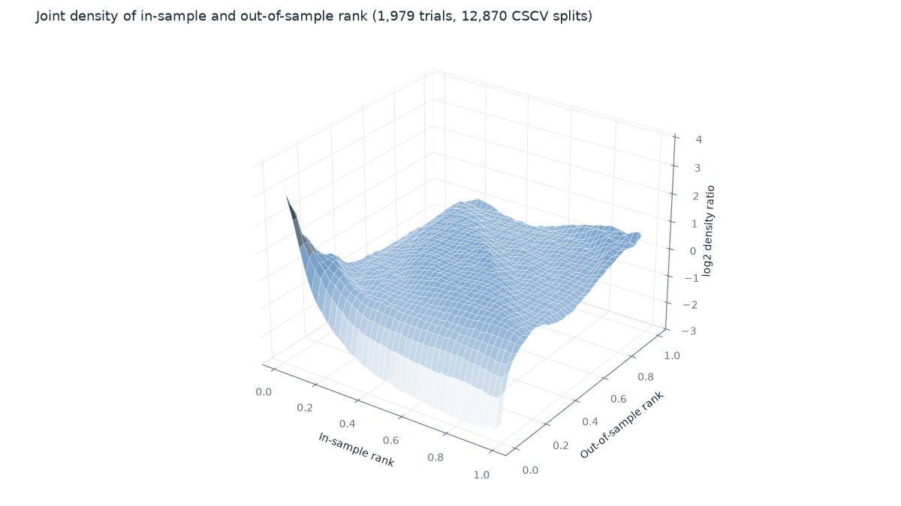

# backtest-overfitting

[](https://github.com/vendraholdings/backtest-overfitting/actions/workflows/ci.yml)

Overfitting diagnostics applied to a complete search of 1,979 machine-learning configurations for a cross-sectional equity strategy.
The best configuration has a net Sharpe ratio of 1.03; the question is how much of that survives selection bias.

> **Scope.** The trials were run on today's index members. A later point-in-time rerun in the
> [quant](https://github.com/vendraholdings/quant) repository shows that the family-level signal is largely survivorship
> bias. This project measures a separate effect, selection bias from searching many configurations, and its diagnostics
> apply unchanged to any trial matrix.



*Figure 3. Joint density of the in-sample and out-of-sample rank of every trial over 12,870 cross-validation splits (log base 2, relative to independence).
An interactive version is on the [project page](https://vendraholdings.github.io/backtest-overfitting/).*

## Results

| Quantity | Value |
|---|---|
| Best net Sharpe ratio among 1,979 trials (mean of all trials: 0.78) | 1.03 |
| Haircut Sharpe ratio after Bonferroni / Holm adjustment for 1,979 tests | 0.62 |
| Deflated Sharpe ratio of the best trial | 0.999 |
| Probability of backtest overfitting (CSCV, S = 16, 12,870 splits) | 0.44 |
| Out-of-sample Sharpe ratio: selected trial / average trial | 0.77 / 0.78 |

The trials share one signal. All of them are profitable, and White's Reality Check and Hansen's SPA test reject the null of no skill (p < 0.001).
The choice among them is not informative: the configuration with the best in-sample Sharpe ratio (1.15 on average) has an out-of-sample Sharpe ratio of 0.77,
no higher than that of an average configuration. Searching more configurations raised the best reported Sharpe ratio only from 0.91 (10 trials) to 1.03.
The trial universe uses current index members, so absolute levels are overstated; the results concern selection, not tradable performance.
Every number above is generated by the code in this repository and quoted, with its method, in the [paper](paper/paper.pdf).

* **Live page:** <https://vendraholdings.github.io/backtest-overfitting/>
* **Paper:** [`paper/paper.pdf`](paper/paper.pdf) (8 pages)

## Methods

| Method | Reference |
|---|---|
| Probability of backtest overfitting by combinatorially symmetric cross-validation (exact, one matrix product) | Bailey, Borwein, López de Prado and Zhu (2017) |
| Probabilistic and deflated Sharpe ratio, minimum track record length | Bailey and López de Prado (2012, 2014) |
| Effective number of trials: eigenvalue, clustering and simulated-null calibration | this repository |
| Bonferroni, Holm and BHY Sharpe haircuts | Harvey and Liu (2015) |
| Reality Check and SPA test with the stationary bootstrap (100,000 resamples) | White (2000); Hansen (2005); Politis and Romano (1994) |
| Monte Carlo validation with planted signals | this repository |

Validation: CSCV is compared with a loop implementation, the deflated Sharpe ratio with an independent implementation (agreement to 1e-13), the SPA test with the `arch` package, and
all diagnostics on synthetic trials with a known answer (paper, Section 4).

## Reproduce

Requires [uv](https://docs.astral.sh/uv/). The trial returns (`data/trials.parquet`, 249 periods by 1,979 trials) are included, so the price data are not needed.

```bash
git clone https://github.com/vendraholdings/backtest-overfitting
cd backtest-overfitting
make all        # tests, results (about 70 s), figures, paper, README and site
make serve      # http://localhost:8000
```

`make all` also renders the hero animation, which needs `ffmpeg` only for the MP4 file. `scripts/export_trials.py` documents how the return matrix was rebuilt from the original per-trial predictions.

## Layout

```
overfit/    cscv.py  sharpe.py  haircut.py  spa.py  trials.py  validate.py  synthetic.py  plots.py  facts.py
scripts/    export_trials.py  run_all.py  make_figures.py  make_hero.py  build_paper.py  build_readme.py
tests/      CSCV vs slow loop, PSR/DSR closed forms, haircuts, bootstrap, SPA, synthetic validation
site/       build.py  (static page; Plotly bundled)
paper/      paper.typ.tmpl  refs.bib  paper.pdf  figures/  (light, for the paper)
docs/       hero.gif  hero.mp4  figures/  (dark, for the README and site)
data/       trials.parquet  configs.parquet
results/    summary.json and tables
```

## References

- Bailey, Borwein, López de Prado, Zhu (2017). The Probability of Backtest Overfitting. *Journal of Computational Finance* 20(4).
- Bailey, López de Prado (2014). The Deflated Sharpe Ratio. *Journal of Portfolio Management* 40(5).
- Bailey, López de Prado (2012). The Sharpe Ratio Efficient Frontier. *Journal of Risk* 15(2).
- Harvey, Liu (2015). Backtesting. *Journal of Portfolio Management* 42(1).
- White (2000). A Reality Check for Data Snooping. *Econometrica* 68(5).
- Hansen (2005). A Test for Superior Predictive Ability. *Journal of Business & Economic Statistics* 23(4).
- Politis, Romano (1994). The Stationary Bootstrap. *Journal of the American Statistical Association* 89(428).

Released under the MIT licence.
